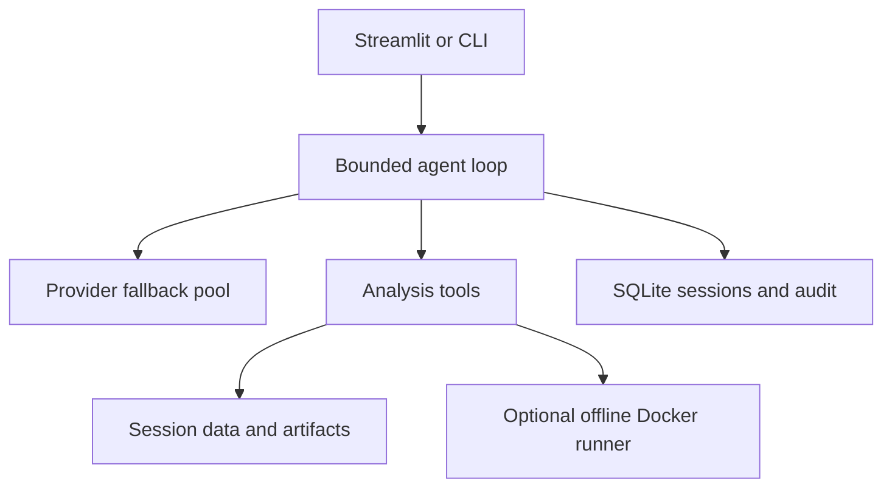

# ◈ Analyst Studio

A personal data and business analyst with real tools, saved evidence, provider fallback, and a no-key demonstration.

**Start here: [START_HERE.md](START_HERE.md).** On Windows, extract the package and double-click `start-windows.bat`.

## What works

| Capability | Implementation |
| --- | --- |
| Natural-language agent | Bounded tool loop using OpenAI-compatible chat APIs |
| Providers | Groq, configurable Gemini, free-only OpenRouter, local Ollama |
| Failure recovery | HTTP 429 cooldown, retry on server errors, configured-provider fallback, saved turns |
| Data inputs | CSV, XLSX sheets, SQLite databases |
| Quality checks | Types, missing values, duplicate rows, numeric summary |
| Numeric analysis | Grouping, date periods, sums/means/counts and other statistics |
| Evidence | Independent sum cross-check, generated aggregate CSV, full local audit log |
| Visualization | Bar, line, scatter plots exported to PNG |
| SQL | Read-only connection, authorizer, blocked ATTACH/PRAGMA/extensions, execution deadline |
| Custom Python | Optional disposable Docker runner; no host exec, no network or keys |
| Research | Opt-in DDGS search with URLs, retrieval times, one-hour cache |
| Deliverables | Markdown reports, PNG charts, CSV results, transcript and JSON audit downloads |
| Sessions | SQLite history and separate input/output folders per analysis |
| No-key experience | Real deterministic demo, clearly distinguished from AI chat |

## Architecture



The language model chooses tools and explains results. Built-in tools perform the calculations. Data and web snippets are untrusted evidence, never instructions. Entire uploaded files are not attached to prompts, but tool summaries, SQL results and Python output are sent to the chosen provider. Use local-only mode with web research disabled for offline processing.

## Setup and CLI

```bash
python -m venv .venv
# Windows: .venv\Scripts\activate
# Linux/macOS: source .venv/bin/activate
pip install -r requirements.txt
# Copy .env.example to .env and optionally add provider credentials.
python -m streamlit run app.py
```

```bash
# No API, real data analysis:
python cli.py --demo
# Your data, with a configured model:
python cli.py --file sales.csv --ask "Inspect the data, summarize revenue by month, verify the total and save a report"
# Resume using the ID printed by the CLI:
python cli.py --session YOUR_PRINTED_ID --ask "Create a chart of those monthly totals"
# Business research (queries leave the computer):
python cli.py --web --ask "Assess demand for a student software service in Dhaka; cite sources and label assumptions"
# Local model only; Docker code execution optional:
python cli.py --local-only --python --file sales.csv --ask "Calculate margins and save a chart"
```

`ANALYST_HOME` controls persistence (default `.analyst/` next to the application). Back up that folder to retain sessions. It can contain sensitive data, prompts, source snippets and outputs; it is excluded from Git. Removing a session from disk is a manual operation in this version. The application has no telemetry; provider/search services have their own policies.

## Configuration and costs

`PROVIDER_ORDER` controls fallback. Missing credentials/model names are skipped. OpenRouter rejects paid model identifiers. Groq/Gemini usage is governed by your account: use free-tier accounts, do not assume API credits come with a chat subscription, and check provider dashboards. No quota bypass or automatic purchase is implemented. If every provider is unavailable, the turn is saved and the app reports the problem; it does not silently fabricate an answer or poll indefinitely.

Calls are bounded to eight model steps per question and twelve tool calls per step. Recent complete conversation turns are selected under an approximate character budget, preserving tool pairs. A single active turn can exceed that history budget; if a provider rejects context, ask a smaller question or start a new session. Tool responses are capped and labeled when truncated. Reported usage counts successful model calls, not provider-side attempts that failed before usage was returned.

## Data semantics

- Inputs up to 25 MB; tabular analysis up to 200,000 rows and 150 columns. Larger data must be split.
- CSV parsing uses pandas defaults; use UTF-8, comma-separated files. Legacy `.xls` is not supported.
- Excel sheet selection is an integer index, starting at zero. Workbook expansion is capped before loading.
- Aggregations retain missing group labels. `count` excludes null values. Numeric sums use pandas behavior (an all-null group can sum to zero); missing counts remain visible.
- Invalid dates are counted and retained as an unknown period, not silently discarded.
- Aggregation previews show up to 50 groups; the downloadable CSV contains all groups.
- SQL results return up to 100 rows. Use SQL aggregates for large tables.
- Charts require at most 500 rows; aggregate first. Line charts follow row order.
- Source currency must be established. Only the bundled synthetic demo is explicitly BDT.

## Python isolation

Build the runner with `docker build -f Dockerfile.runner -t analyst-python:local .`.
Each execution mounts only the session inputs read-only, runs as a non-root user with no network, drops capabilities, and limits memory, CPU, process count, writable tmpfs size and runtime. The Docker socket and application environment are never mounted. Output collection accepts regular PNG/CSV/MD/JSON/TXT files, renames them, and does not extract tar paths or links. Output text is capped.

Docker is an isolation boundary, not a guarantee against every kernel/container vulnerability. This is a **single-user local app**, not an authenticated multi-tenant service. Do not expose port 8501 or a Docker socket publicly. No automatic hosting is configured. The web research tool returns snippets, not fully verified page contents; the agent must label this limitation.

## Validation

Run `pip install pytest`, then `python -m pytest -q`.

See [VALIDATION.md](VALIDATION.md) for actual execution results and untested integrations. Tests cover calculations, Excel, query restrictions, malformed tool calls, mocked provider fallback, session persistence, interrupted calls, history compaction, UI demo and new-session creation. CI runs the same suite without secrets.

The `examples/` folder contains outputs from the verified demo: **63,000 BDT total**; monthly totals **16,000**, **30,000**, **17,000**. These are synthetic demonstration results, not market evidence.

## Differences from the PDF prototype

- Replaced direct host `exec()` with an opt-in disposable Docker runner.
- Added built-in deterministic tools so useful analysis works without Docker.
- Replaced SQL prefix checking with SQLite read-only mode and an authorizer.
- Added bounded retry/fallback, provider cooldowns, whole-turn history trimming and usage logging.
- Added persistent sessions, input filename validation, immutable content-addressed uploads and artifact downloads.
- Added free-only OpenRouter routing, local-only mode, opt-in web access and no-key demo.
- Avoided hard-coded Gemini names and promises of unlimited/free 24-hour operation.

## Provider and tool references

Documentation checked during implementation; availability and quotas can change.
- Groq models: https://console.groq.com/docs/models
- Groq local tool calling: https://console.groq.com/docs/tool-use/local-tool-calling
- Groq limits: https://console.groq.com/docs/rate-limits
- Gemini compatibility: https://ai.google.dev/gemini-api/docs/openai
- OpenRouter free router: https://openrouter.ai/docs/guides/routing/routers/free-router
- Ollama compatibility: https://docs.ollama.com/api/openai-compatibility
- Streamlit tests: https://docs.streamlit.io/develop/api-reference/app-testing

## Customer retention tool

This version integrates with the sibling Customer Churn Predictor backend. Launch both from the repository root with `start-retention-windows.bat`. The **Customer retention** tab and `cli.py --retention --file customers.csv` produce a report, prioritized CSV, segment breakdown, chart and per-customer sensitivity evidence without an AI key. Chat exposes the same operation as `analyze_retention`.

See the root README for limits, setup and interpretation. The model is trained on synthetic telecom data; sensitivity is not causal, and monthly charge exposure is not expected lost revenue. The connector is restricted to loopback addresses and returns only aggregate evidence and filenames to the LLM.
